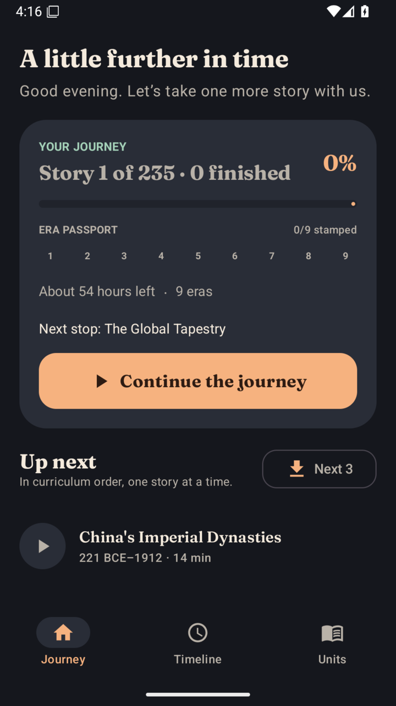
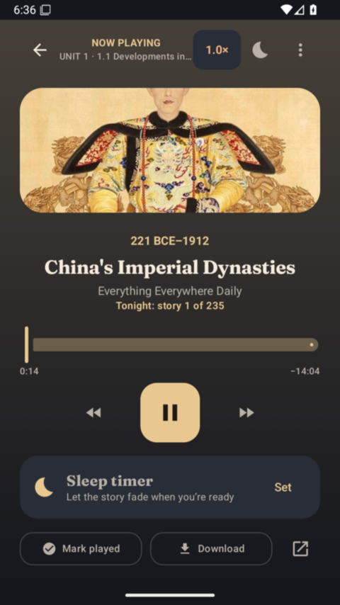
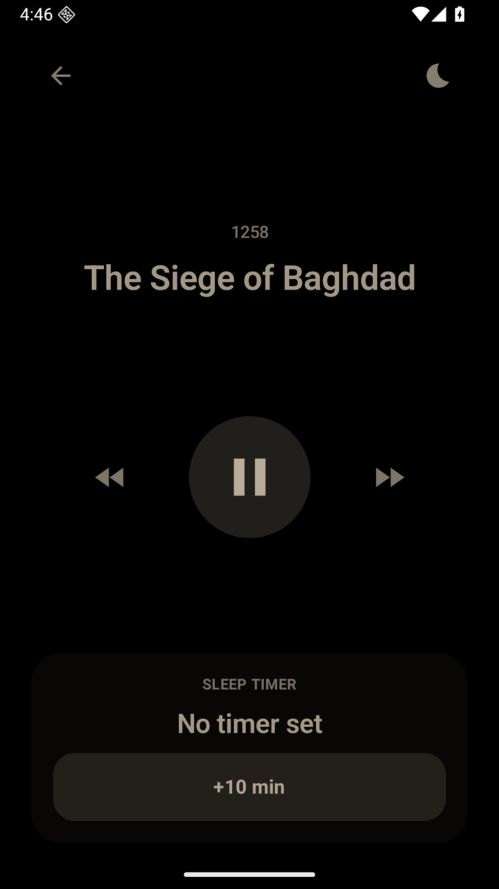
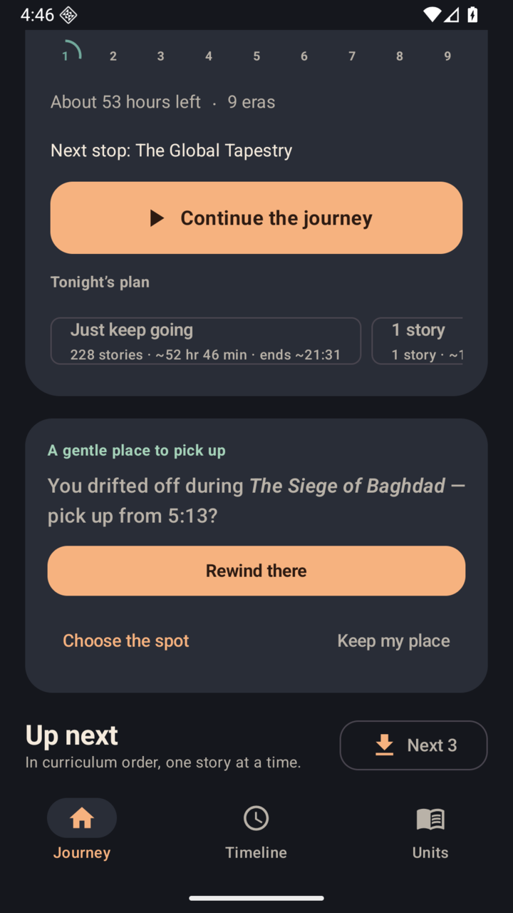
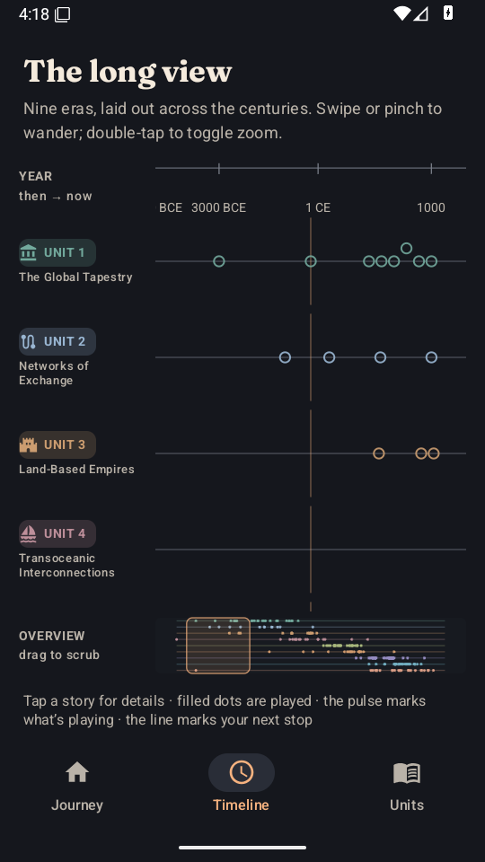
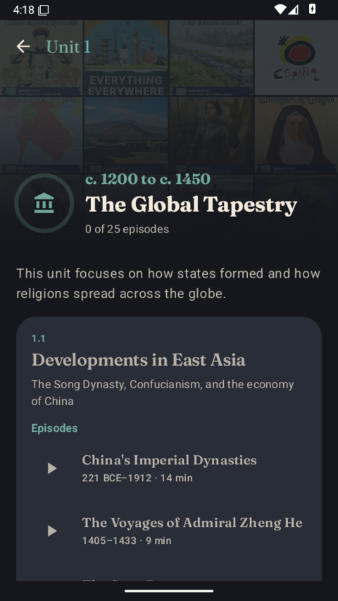
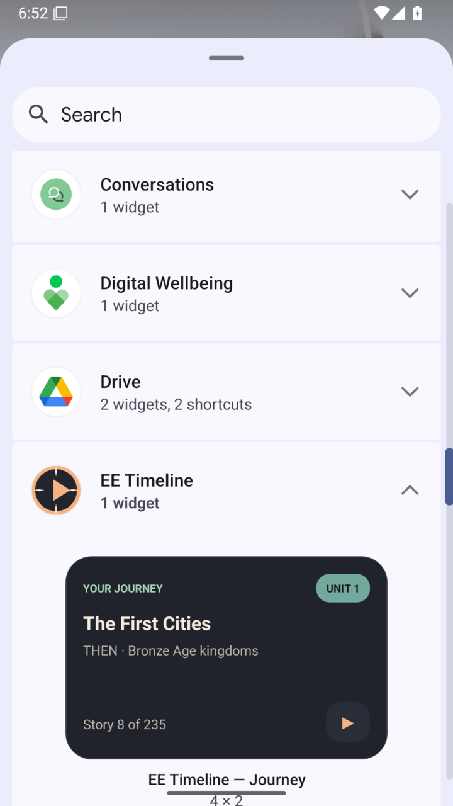
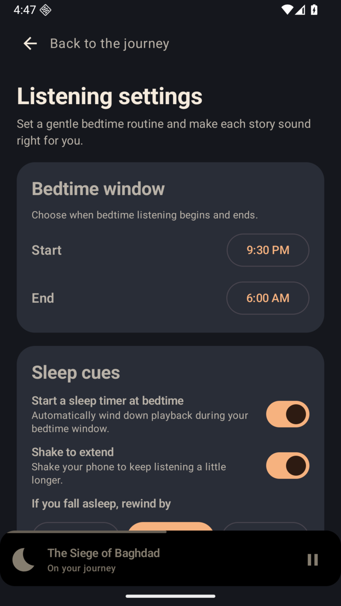

# EE Timeline

A night-friendly Android companion for listening to *Everything Everywhere Daily* in AP World History curriculum order—with a journey plan, a zoomable history timeline, and bedtime playback tools.

[](https://github.com/DarkoKuzmanovic/ee-timeline/actions/workflows/build.yml) [](LICENSE)

> **Unofficial, independently made project.** EE Timeline is not affiliated with, endorsed by, or sponsored by *Everything Everywhere Daily*, its host Gary Arndt, Everything Everywhere, or the College Board. AP® and Advanced Placement® are College Board trademarks; the College Board does not endorse this project.

Follow the [Everything Everywhere Daily podcast](https://everything-everywhere.com/) and its [public RSS feed](https://feeds.megaphone.fm/ADV3162807280), organized around the [Everything Everywhere AP World History curriculum](https://everything-everywhere.com/everything-everywhere-ap-world-history-curriculum/).

## Screenshots

<table>
  <tr>
    <td></td>
    <td></td>
    <td></td>
    <td></td>
  </tr>
  <tr>
    <td></td>
    <td></td>
    <td></td>
    <td></td>
  </tr>
</table>

## Features

- **Journey and Tonight’s plan:** listen in curriculum order, choose a plan for tonight, and keep your place across episodes.
- **Sleep timer:** fade audio out, then use the drift-off rewind to return to where you fell asleep; shake the device to extend playback.
- **Bedtime mode:** configure a bedtime window, automatic sleep timer, rewind amount, and shake-to-extend behavior.
- **Listening controls:** optional voice boost and silence skipping.
- **Explore history:** zoom and pan across an episode timeline, or use its overview; browse curriculum units, era pages, and their episodes.
- **Downloads and offline playback:** save episodes on the device and listen without a network connection.
- **Quick controls:** control the journey from the home-screen widget or Android Quick Settings tile.

## Privacy and network use

The app has no sign-in/account feature or analytics SDK. Playback progress, played status, sleep-session details, and preferences are stored in local app databases and preferences.

The app ships with `app/src/main/assets/curriculum.json`: its curriculum order is assembled from the public curriculum page, and episode audio/artwork URLs come from the public podcast feed. It does **not** fetch the RSS feed or curriculum page at runtime. Streaming and downloads request audio from the feed-provided URLs; those requests may redirect to podcast delivery hosts. Cover artwork is fetched from its feed-provided image URL when displayed. Opening an episode’s page link hands off to the device’s browser.

## Build, test, and install

Requirements: Android 8.0 (API 26) or newer, JDK 17 or newer, and Android SDK Platform 37. The Gradle Wrapper downloads the project’s pinned Gradle version.

Build and install a debug APK on a connected device:

```sh
./gradlew assembleDebug
adb install -r app/build/outputs/apk/debug/app-debug.apk
```

Run the unit tests with:

```sh
./gradlew testDebugUnitTest
```

A release APK can be assembled with `./gradlew assembleRelease`, but this project has no release signing configuration, so the output is unsigned. To sign via Gradle, add a signing configuration that reads your keystore path, alias, and passwords from private Gradle properties in `~/.gradle/gradle.properties` or CI secrets, then run `./gradlew assembleRelease`. Alternatively, use Android's `apksigner` on the unsigned APK:

```sh
./gradlew assembleRelease
"$ANDROID_HOME/build-tools/37.0.0/apksigner" sign \
  --ks /path/to/release.jks \
  --ks-key-alias "$ANDROID_KEY_ALIAS" \
  --out app/build/outputs/apk/release/app-release-signed.apk \
  app/build/outputs/apk/release/app-release-unsigned.apk
"$ANDROID_HOME/build-tools/37.0.0/apksigner" verify --verbose \
  app/build/outputs/apk/release/app-release-signed.apk
```

Provide the keystore and its password securely; never commit the keystore or signing credentials.

## Curriculum data

`app/src/main/assets/curriculum.json` is generated by reconciling the public [curriculum page](https://everything-everywhere.com/everything-everywhere-ap-world-history-curriculum/) with the [podcast RSS feed](https://feeds.megaphone.fm/ADV3162807280). Regenerate it with:

```sh
python3 tools/dataset/build_dataset.py
```

The generator uses only Python’s standard library. `--verify` additionally probes every audio URL, and `--out PATH` writes the result to another location. Manual corrections for curriculum links and approximate timeline years live in `tools/dataset/build_dataset.py`; update them there when source data needs correction.

## Project layout

```text
.
├── app/
│   └── src/
│       ├── main/
│       │   ├── assets/curriculum.json
│       │   ├── java/com/eetimeline/   # core, playback, UI, and widget
│       │   └── res/
│       └── test/
├── .github/workflows/build.yml        # CI build and unit tests
├── docs/screenshots/
├── gradle/                            # version catalog and wrapper
├── tools/dataset/build_dataset.py
├── gradlew
├── LICENSE
└── README.md
```

## Third-party notices and license

- The bundled **Fraunces** font is licensed under the SIL Open Font License 1.1; see [`fraunces_ofl.txt`](app/src/main/res/raw/fraunces_ofl.txt).
- **AndroidX** and **AndroidX Media3** libraries are licensed under Apache License 2.0.
- Curriculum ordering and episode metadata are derived from the linked public curriculum page and podcast RSS feed. Podcast episodes, audio, artwork, and other third-party content remain the property of their respective owners.

The MIT license in [`LICENSE`](LICENSE) applies to this project’s code only. It does not relicense the Fraunces font, podcast audio or artwork, curriculum material, or other third-party content; those remain subject to their owners’ rights and applicable terms.
